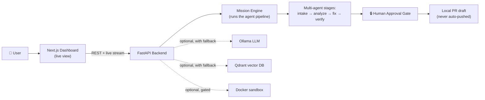
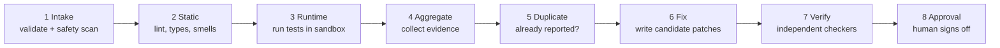
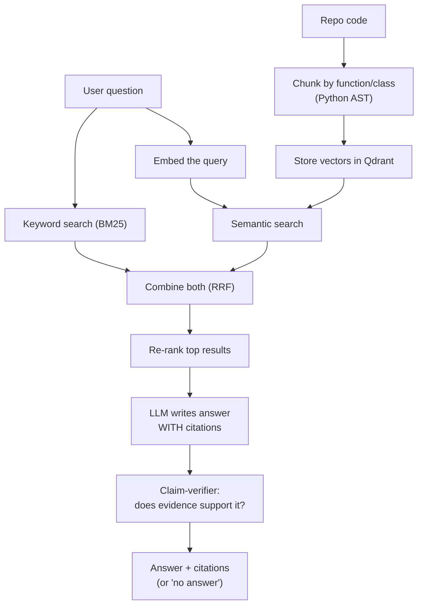
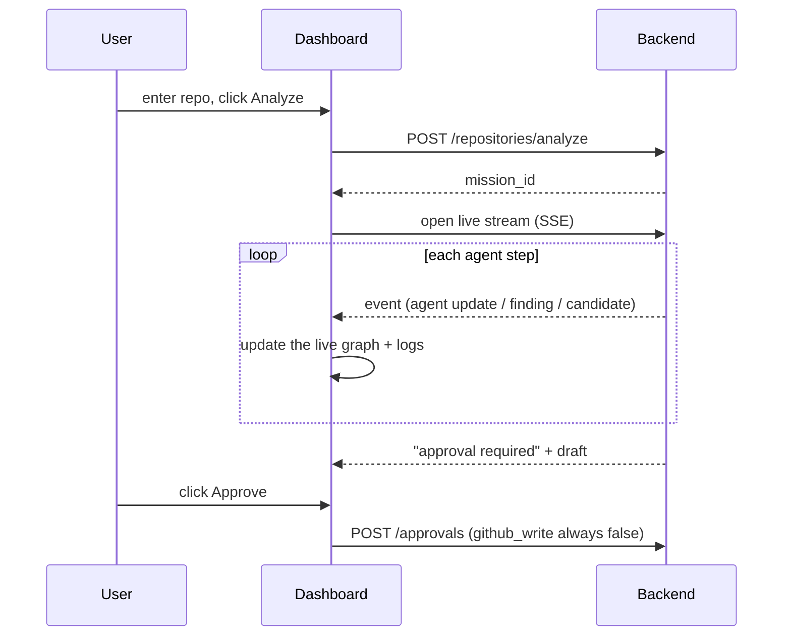

# CareerForge AI — Interview Explanation Guide

> Your personal cheat-sheet for explaining this project in an interview.
> Simple English. Memorable structure. Everything here is **true about the real code**,
> so you can go deep with confidence. Author: **Arpit Sahu**.

---

## 0. The 30-second pitch (memorize this)

> "I built **CareerForge AI**, a local-first, multi-agent platform that analyzes a GitHub
> repository the way a careful engineer would — a team of AI agents intake the repo, run
> static and runtime analysis, find bugs, look for duplicate issues, write candidate fixes,
> and then a **separate, independent set of verifier agents checks those fixes** before a
> **human approves** anything. Nothing is pushed to GitHub without approval. It's a Python
> FastAPI backend with a Next.js real-time dashboard, and it's designed so every heavy piece
> — the LLM, the vector database, the sandbox — is **optional**: if it's not there, the
> system falls back gracefully and still runs. It's 16 build phases, ~11 packages, and
> ~146 automated tests."

If they want one line: **"A multi-agent AI system that finds, fixes, and independently
verifies code issues, with a human-approval gate and a live dashboard."**

---

## 1. What problem does it solve? (the "why")

Say this: *"A resume claims skills, but employers trust **evidence** — real code, tests, and
merged contributions. CareerForge turns information into verified career evidence: it finds
real open-source contribution opportunities, analyzes repos safely, proposes fixes, and
**proves** each fix works before a human signs off."*

The key insight that impresses: **most AI 'coding assistants' just generate text and hope
it's right. Mine treats the AI's output as a *proposal* that must pass independent
verification and human approval — like a real code-review process, not a chatbot.**

---

## 2. The big picture (one diagram to draw on a whiteboard)

**How to explain it in words:** "The user opens the dashboard and enters a repo. The backend
starts a *mission* — a multi-stage pipeline of AI agents. Each step streams live to the
dashboard. At the end, a human reviews and approves. The LLM, vector DB, and sandbox are all
optional — the system probes for them and falls back if they're missing."

---

## 3. The mission pipeline (the heart — know these 8 stages)

This is the most important thing to explain well. Draw this:

Say it like a story: *"Intake validates the repo and does a safety scan. Static analysis
finds code issues. Runtime actually runs the tests in a locked-down sandbox. Aggregate
collects all the evidence. Duplicate detection checks if the issue was already reported. Fix
agents write 2–3 candidate patches. **Verify agents — which are different agents than the
ones that wrote the fix — independently check each patch.** Finally, a human approves."*

**The line that wins interviews:** *"A fix agent is never allowed to verify its own work —
I enforce that in code with an assertion. That's how I avoid the classic failure where an AI
grades its own homework and always says it passed."*

---

## 4. The tech stack (what you used, and WHY — they always ask why)

| Layer | Tech | Why you chose it (say this) |
|---|---|---|
| **Backend** | Python 3.12, **FastAPI** | Fast, async, great for streaming; industry standard for AI/ML services |
| **Data models** | **Pydantic v2** | Typed request/response everywhere; one schema shared across the whole app |
| **Live updates** | **Server-Sent Events (SSE)** | One-way server→browser streaming with automatic reconnect — simpler than WebSockets for a telemetry feed |
| **LLM** | **Ollama** (local, e.g. `qwen2.5:7b`) | Runs locally, free, private; no paid API needed |
| **Embeddings / RAG** | **Ollama `nomic-embed-text` + Qdrant** | Local embeddings + a real vector database for semantic search over code |
| **Retrieval** | **Hybrid: dense + BM25 → RRF → rerank** | Combines meaning-based search with exact keyword search for better results |
| **Frontend** | **Next.js 14 + TypeScript** | Modern React with the App Router; type-safe end to end |
| **Live graph** | **React Flow** | Draws the animated multi-agent graph |
| **3D + charts** | **React Three Fiber, ECharts, Monaco** | Skill constellation (3D), pulse charts, code-diff viewer |
| **State** | **Zustand + TanStack Query** | Lightweight live mission store + server-data caching |
| **Sandbox** | **Docker / Podman** | Runs untrusted repo code in an isolated, hardened container |
| **Observability** | **OpenTelemetry (+ built-in fallback)** | Traces every request/model/retrieval call |

**Memory hook:** *"Python + FastAPI backend, Next.js frontend, Ollama for the LLM, Qdrant
for RAG, Docker for the sandbox — all local, all free, all optional with fallbacks."*

---

## 5. LLM & Agent experience — the part that shows your depth

When they ask *"what did you actually do with LLMs and agents?"*, hit these points:

**a) Multi-agent orchestration, not one big prompt.**
"I didn't use one giant LLM call. I designed a **pipeline of specialized agents** — intake,
static, runtime, duplicate, fix, verify — each with a narrow job, a typed input/output, and a
place in a graph. That's more reliable and debuggable than one mega-prompt."

**b) Retrieval-Augmented Generation (RAG) done properly.**
"I built a real RAG pipeline: I chunk code by **function/class using the Python AST** (not
blind text splitting), embed it, store it in Qdrant, and retrieve with a **hybrid** of
semantic search + keyword search, fused with **Reciprocal Rank Fusion**, then rerank.
Crucially, **every answer must cite its sources**, and a **claim-verifier rejects any claim
the retrieved text doesn't support** — so the LLM can't hallucinate."

**c) The LLM is a proposer, not an authority.**
"The LLM suggests fixes and explanations, but the **diff itself is computed deterministically
with `difflib`, never hallucinated by the LLM**. Then independent verifiers run real tools
(ruff, mypy, the tests) to check it. The LLM never gets to say 'the test passed' — a real
tool does."

**d) Safety and guardrails (very important for LLM roles).**
"I treat all repo content as untrusted. Secrets never reach the LLM or logs. Any command an
LLM might suggest must pass an **allowlist policy** before it can run. And the sandbox that
runs code is **off by default** and heavily locked down."

**e) Graceful degradation.**
"If Ollama isn't running, embeddings fall back to a deterministic hash function; if Qdrant
isn't running, it uses an in-memory store. Same output shape either way. This means the
whole thing runs on a laptop with just Python and Node."

---

## 6. How RAG works (draw this if they ask about retrieval)

One-liner: *"Chunk smartly, search two ways, fuse, rerank, answer with citations, then verify
the answer against the evidence — and say 'I don't know' when the evidence is weak."*

---

## 7. The 3 golden rules (say these — they show engineering maturity)

1. **"Real when present, fallback when absent — the contract never changes."**
   Every external tool is optional; the system degrades gracefully and logs it.

2. **"Nothing dangerous happens without an explicit gate."**
   GitHub writes and code execution are OFF by default. The approval endpoint *hard-codes*
   `github_write = false`. The sandbox needs a flag ON + Docker present + the command to pass
   a policy check.

3. **"A fix agent may never verify its own candidate."**
   Verifier agents are always different from the agents that wrote the fix. Enforced by an
   assertion in code.

---

## 8. Challenges I faced and how I solved them (THE most-asked question)

Pick 3–4 of these and tell them as short stories. Each is a real thing that happened.

**Challenge 1 — "How do I demo a heavy AI system that needs Docker, a GPU, a vector DB,
and a database — on a normal laptop?"**
- *Problem:* Requiring all that infrastructure would make the project impossible to run or
  demo, especially on Windows.
- *Solution:* I made a **"demo mode" a first-class runtime**. It runs a **scripted,
  deterministic simulation** of the full mission that emits the *exact same live events* the
  real system would — over the real streaming transport. So the entire flow (agents, fixes,
  verification, approval) works with **just Python and Node, no Docker, no GPU**. Bonus: the
  same deterministic engine doubles as my **test fixture**, so the demo and the tests can
  never drift apart.
- *Takeaway line:* "I separated the *contract* from the *implementation*, so a fake backend
  and a real backend are interchangeable."

**Challenge 2 — "How do I stop the AI from marking its own bad work as correct?"**
- *Problem:* If the same agent writes and checks a fix, it always says "looks good."
- *Solution:* **Structural independence** — verifier agents are separate, and I enforce
  `verifier != author` with an assertion. Verification runs **real tools** (ruff, mypy,
  tests), and I deliberately keep a **REJECTED example** in every run so I can prove the
  verification actually rejects bad fixes, not just rubber-stamps them.

**Challenge 3 — "How do I run untrusted repository code safely?"**
- *Problem:* Cloning and running strangers' code is dangerous.
- *Solution:* Defense in depth — a **static safety pre-flight** scan (blocks obvious malware
  patterns), an **allowlist command policy** (an LLM can't smuggle `rm -rf` or `curl | sh`),
  and a **hardened container** (non-root, no network, read-only filesystem, dropped Linux
  capabilities, CPU/memory limits, repo mounted read-only, no secrets). And it's **off by
  default** behind a feature flag.

**Challenge 4 — "The LLM kept failing on large inputs."**
- *Problem:* When embedding whole classes, the local model returned a 500 error — the input
  exceeded its context window.
- *Solution:* I **truncated inputs to a safe character budget** before embedding, and made
  the embedder **fall back to a deterministic hash embedder** if the LLM is unreachable — so
  the pipeline never crashes.

**Challenge 5 — "A dependency version silently broke the app."**
- *Problem:* A new FastAPI version had a bug where mounted routers registered **zero routes**
  — endpoints just silently vanished.
- *Solution:* I **pinned FastAPI to the known-good version range** with a code comment
  explaining why, and matched the related dependency pins. Lesson: verify behavior, don't
  trust "latest."

**Challenge 6 — "The vector DB rejected my IDs."**
- *Problem:* Qdrant only accepts UUID or integer point IDs, but my chunk IDs were hashes.
- *Solution:* I fold the stable hash into a **deterministic UUIDv5** for the point ID while
  keeping the original ID in the payload — so re-indexing stays **idempotent** (same chunk =
  same ID, no duplicates).

**Challenge 7 — "The dashboard showed a network error at startup."**
- *Problem:* The frontend loaded but the backend wasn't running, so it showed a red error.
- *Solution:* Two parts — a `make dev` command that starts **both** servers together, and a
  **client-side mock fallback**: if the live stream drops mid-mission, the UI transparently
  switches to a bundled simulation emitting the same events, so the dashboard is never dead.

---

## 9. Live updates — how the dashboard streams (know this flow)

One-liner: *"The browser opens a Server-Sent Events stream; the backend pushes every agent
step as it happens; if the connection drops it reconnects from the last event ID it saw."*

---

## 10. Numbers that sound impressive (all true — use them)

- **16 build phases**, delivered end to end.
- **~11 Python packages**, one per capability (RAG, GitHub client, static analysis, sandbox,
  duplicate detection, patch generation, verification, etc.).
- **~146 automated tests**, all passing; type-checked (mypy) and linted (ruff) clean.
- **34 REST endpoints** + a live streaming endpoint.
- **~36 typed data models**, shared across backend and frontend.
- **6 frontend screens**: Command Center, Contribution Lab, Skill Constellation (3D),
  Industry Pulse, Public Portfolio, plus the landing page.
- Runs **cross-platform** (Windows/macOS/Linux) with just Python + Node.

---

## 11. Likely interview questions + your answers

**Q: Is this "real AI" or just scripted?**
A: "Both, by design. The *real* implementation uses Ollama, Qdrant, and real tools. But I
also built a deterministic demo mode so it runs anywhere. They speak the exact same contract,
so the real and simulated engines are interchangeable — and I'm always honest about which is
running (the health endpoint reports it)."

**Q: How is this different from GitHub Copilot / ChatGPT?**
A: "Those generate text and trust it. Mine treats AI output as a *proposal* that must pass
independent verification and human approval — real tools check the fix, and a human signs off.
It's an AI *system with guardrails*, not a chatbot."

**Q: What's the hardest part of multi-agent systems?**
A: "Stopping agents from trusting each other blindly, and keeping the whole thing debuggable.
I solved both with typed contracts between agents, structural verifier independence, and a
single append-only event log that's the source of truth."

**Q: How do you prevent hallucination?**
A: "Retrieval with mandatory citations, a claim-verifier that rejects unsupported claims, a
'no-answer' path when evidence is weak, and — for fixes — computing the diff deterministically
instead of letting the LLM invent it."

**Q: How would you make it production-ready?**
A: "Wire the real durable orchestration (I designed the boundary: fast in-memory graphs for
agent loops, a durable workflow engine for the long-lived mission with its multi-day human
wait), add a real database for persistence, and turn on the observability exporter. The
interfaces are already there — it's additive, not a rewrite."

---

## 12. Your 60-second closing statement

> "The thing I'm proudest of is that it's not a demo that only works in one perfect setup.
> It's engineered like real software: every dependency is optional with a graceful fallback,
> every dangerous action is gated, the AI's work is independently verified, and there are
> ~146 tests proving it. I learned how to design **multi-agent pipelines**, build a **proper
> RAG system with citations and hallucination guards**, run **untrusted code safely in a
> sandbox**, and stream a **live multi-agent dashboard** — end to end, backend to frontend."

---

### Quick-recall map (glance before you walk in)

- **What:** multi-agent AI system that finds, fixes, and *independently verifies* code issues, with human approval.
- **Stack:** Python/FastAPI · Ollama LLM · Qdrant RAG · Next.js/React · Docker sandbox · SSE streaming.
- **Big ideas:** agents-not-one-prompt · RAG with citations · verify-don't-trust · gated safety · graceful fallbacks.
- **Top challenge:** "run a heavy AI system anywhere" → demo mode + optional-with-fallback + identical contract.
- **Numbers:** 16 phases · 11 packages · 146 tests · 34 endpoints.
