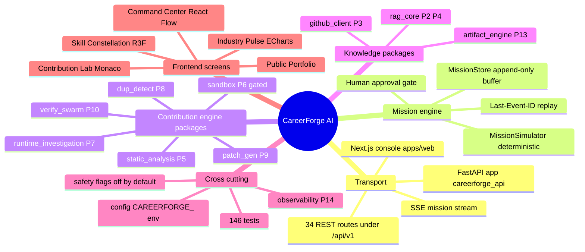
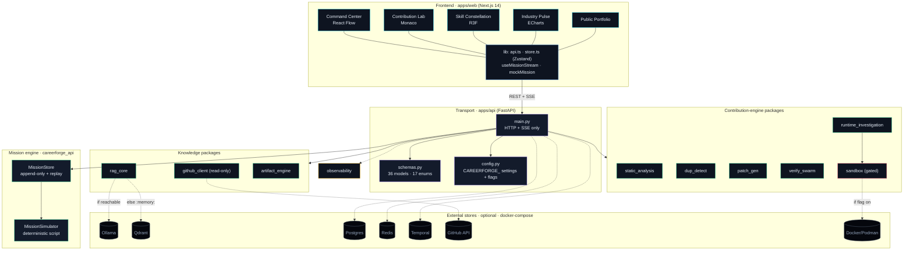
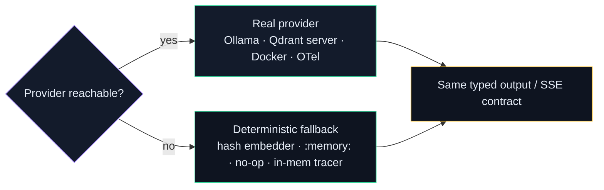
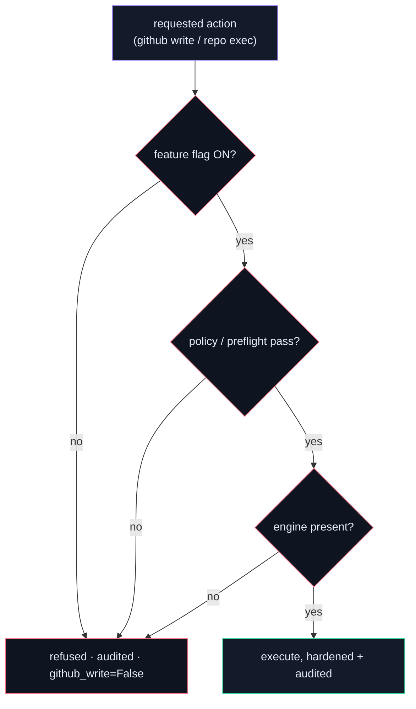
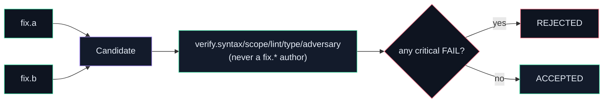
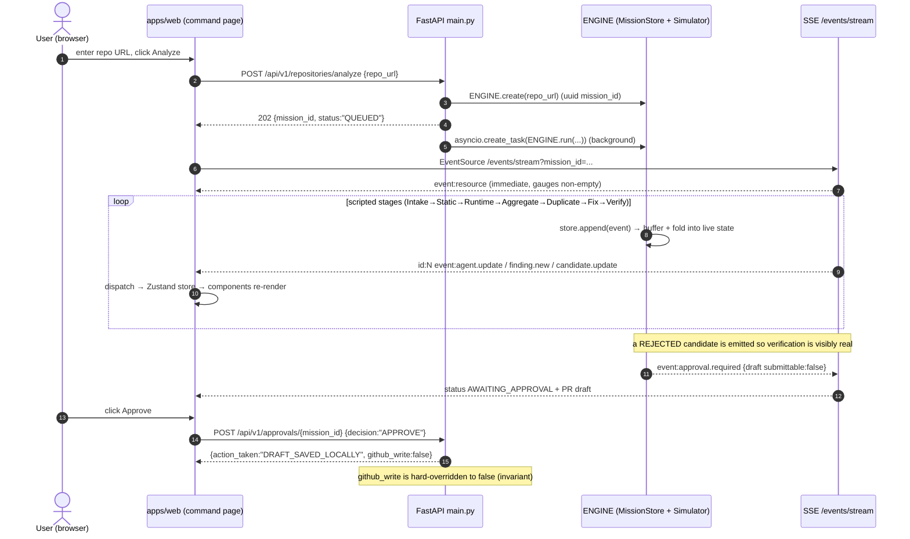
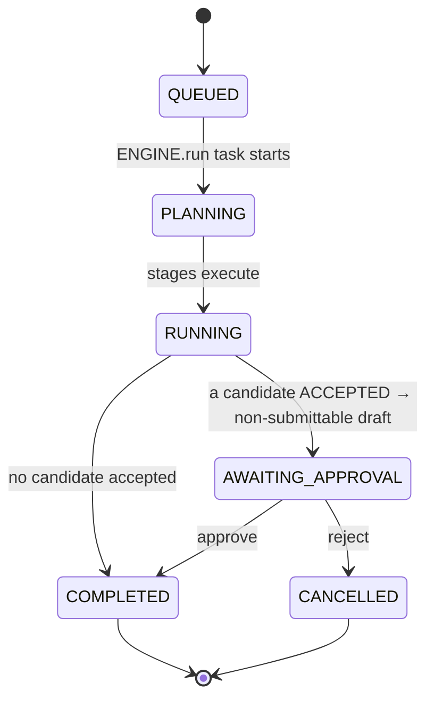
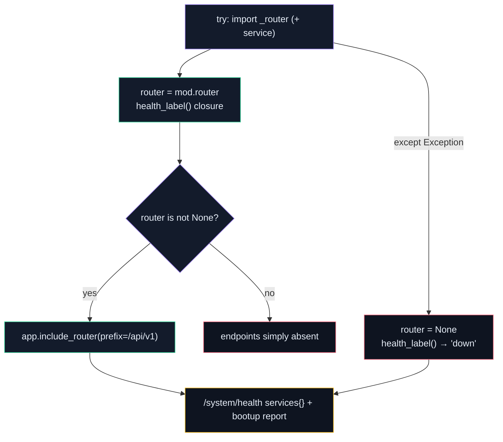
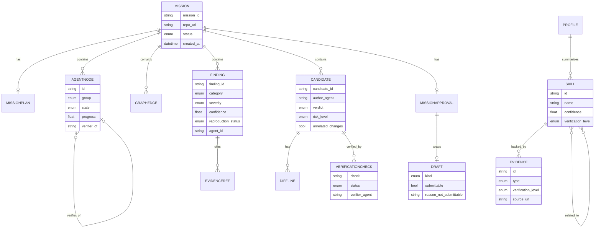

<!--
  CareerForge AI — Architecture & Decision Guide
  Author / copyright holder: Arpit Sahu. Copyright (c) 2026 Arpit Sahu. MIT License.
  This file and docs/architecture/index.html are kept in sync (same content + diagrams).
-->

# CareerForge AI — Architecture & Decision Guide

> **Audience:** an engineer who needs to understand, modify, or explain any part of this
> system — and answer *"why was it built this way?"* — without reading the source first.
> Every fact below was verified against the code, `pyproject.toml`/`package.json` manifests,
> the three ADRs in [`../decisions/`](../decisions), and the test suites.

---

## 1. Mental model

CareerForge AI is a **local-first, modular-monolith** platform that turns information into
*verified career evidence*: it analyzes a GitHub repository through a multi-stage "mission"
(intake → static analysis → runtime → aggregate → duplicate-check → fix → **independent
verification** → **human approval**), and separately maintains an evidence-backed skill
profile, an industry-pulse feed, artifact assignments, and a public portfolio. The backend
is one FastAPI deployable (`apps/api`, package `careerforge_api`) that streams a live mission
to a Next.js console (`apps/web`) over **Server-Sent Events**; each real capability (RAG,
GitHub, static analysis, sandbox, etc.) is its own installable package under `packages/`.

**The one sentence that explains most of the design:**

> **Use the real provider when it's present, a dependency-free fallback when it isn't — so the
> whole system runs anywhere with just Python + Node, while the wire contract stays identical
> to the fully-provisioned deployment.**

That single principle explains: why there's a `demo` runtime that scripts a realistic mission
([ADR-0003](../decisions/ADR-0003-demo-simulation-mode.md)); why embeddings fall back from
Ollama to a hash embedder; why the vector store falls back from a Qdrant server to in-process
`:memory:`; why the sandbox no-ops safely without Docker; why observability falls back from
OpenTelemetry to an in-memory tracer; why every subsystem is *optional behind an interface*
and reports its live mode in `GET /system/health`.

---

## 2. System mindmap

---

## 3. Layered component map

Color = role. Each package is an **optional dependency behind a typed interface**; the
transport layer holds no domain logic; external stores are never required in demo mode.

**Why this shape (from [ADR-0001](../decisions/ADR-0001-modular-monolith.md)):** a
modular monolith — one backend + one frontend deployable with **strong internal seams** —
gives local-first operability (two processes, no infra) *and* clean ownership boundaries,
without the operational cost of microservices for a single-developer target. Domain logic
lives in sibling modules and `packages/`; `main.py` owns only HTTP/SSE. Heavy capabilities
are optional dependencies behind interfaces, each with a mock/stub so **demo mode always
runs**.

---

## 4. Golden rules (invariants everything obeys)

### Rule 1 — Real-when-present, fallback-when-absent; the contract never changes

Every external dependency is probed; on absence the subsystem degrades to a deterministic,
network-free implementation and *logs* the downgrade (never silent). The event/JSON contract
is identical either way.

### Rule 2 — Nothing dangerous happens without an explicit gate

GitHub writes and untrusted-code execution are `false` by default (`CAREERFORGE_FLAG_*`).
The approval endpoint **hard-overrides** `github_write=False`. The sandbox refuses to run
unless the flag is on **and** an engine is present **and** the command passes the allowlist
policy — and a HIGH-risk static preflight blocks execution regardless of the flag.

### Rule 3 — A fix agent may never verify its own candidate

Verification independence is *structural*: verifier agent ids are `verify.*`, patch authors
are `fix.*`; `verify_candidate` asserts `verifier_agent != author_agent` for every check.
Any critical FAIL ⇒ `REJECTED`. The simulated mission always includes a REJECTED candidate so
verification is visibly real.

---

## 5. Representative end-to-end flow — a repository mission

If the SSE connection fails 3× (exponential backoff 800 ms→8 s), the frontend transparently
swaps to `runMockMission`, which emits the **identical** event names into the same dispatch —
so the store/UI path is unchanged (Rule 1 applied on the client).

---

## 6. Decision register

Status legend: 🟢 real & default · 🟡 optional/when-provisioned · 🔴 off by default (safety).

### Architecture & packaging

| Choice | Why THIS (vs alternatives) | Trade-off accepted | Where in code |
|---|---|---|---|
| 🟢 Modular monolith | Local-first target needs a 2-process boot with no infra; microservices' service-discovery/per-service-deploy cost buys nothing at single-dev scale ([ADR-0001](../decisions/ADR-0001-modular-monolith.md)) | No independent per-module scaling; discipline needed to keep seams clean | `apps/api`, `apps/web`, `packages/*` |
| 🟢 One package per capability (10) | Clear ownership seams + independent tests; each is an *optional dep behind an interface* so demo always boots | 11 `pyproject.toml` files to maintain; editable installs via `[tool.uv.sources]` | `packages/*/pyproject.toml`, `apps/api/pyproject.toml` |
| 🟢 Contract-first (`docs/*_CONTRACT.md`) | Frontend + backend + simulation all target one fixed JSON/SSE shape, so real vs. simulated engine are interchangeable | Contract drift must be caught by tests, not the compiler | `docs/API_CONTRACT.md`, `apps/web/src/lib/types.ts`, `careerforge_api/schemas.py` |
| 🟢 Demo/simulation as a first-class runtime | Show the *complete* mission flow with just Python+Node; Windows-friendly; doubles as the deterministic test fixture ([ADR-0003](../decisions/ADR-0003-demo-simulation-mode.md)) | Risk of mistaking demo for real analysis — mitigated by `health:"mock"` + honest status docs | `careerforge_api/simulation.py`, `APP_ENV=demo` |

### Transport & API

| Choice | Why THIS (vs alternatives) | Trade-off accepted | Where in code |
|---|---|---|---|
| 🟢 FastAPI **pinned `>=0.115,<0.116`** | 0.139.x ships a broken `include_router` that silently registers zero routes — verified pin with a code comment | Stuck below latest until upstream fix; `starlette` pinned to match | `apps/api/pyproject.toml` deps |
| 🟢 SSE (`sse-starlette`) for the mission stream | One-way server→client streaming with native reconnect via `Last-Event-ID`; simpler than WebSockets for a telemetry feed | No client→server channel on the same connection (fine — actions are REST) | `main.py` `/events/stream`, `EventSourceResponse` |
| 🟢 `sse-starlette` pinned `>=2.1,<3` | 3.x needs `starlette>=0.49`, conflicting with the FastAPI 0.115 pin | Older sse-starlette line | `apps/api/pyproject.toml` |
| 🟢 Pydantic v2 everywhere | One typed model set shared across transport, engine, and packages; `model_dump(mode="json")` gives exact contract JSON | v2 migration cost (already paid) | `schemas.py` (36 models, 17 enums) |
| 🟢 Uniform error envelope | Predictable `{error:{code,message,detail}}` for every failure; frontend `ApiError` maps it | Slightly more handler code | `main.py` `_error_response` + exception handlers |

### Knowledge / RAG

| Choice | Why THIS (vs alternatives) | Trade-off accepted | Where in code |
|---|---|---|---|
| 🟡 Ollama embeddings, 🟢 hash fallback | Local, free embeddings when Ollama is up; a deterministic `blake2b` 768-dim `HashEmbedder` keeps RAG + tests fully offline | Hash vectors aren't semantically meaningful (tests/CI only) | `rag_core/embeddings.py` `get_embedder` |
| 🟡 Qdrant server, 🟢 `:memory:`/on-disk fallback | Real ANN when a server is reachable (0.75 s socket pre-flight); `qdrant-client` local mode needs no Docker | Local mode is in-process/not shared | `rag_core/vector_store.py` `_build_client` |
| 🟢 Hybrid dense + BM25 → **RRF (k=60)** → rerank | Dense recall + exact-term (BM25 Okapi k1=1.5,b=0.75, exact-boost 2.0) precision; RRF fuses without score calibration | Two indexes to maintain; k=60 is a fixed heuristic | `rag_core/retrieval.py`, `rag_core/bm25.py` |
| 🟢 AST-aware chunking | Chunk by function/class/method/module-docstring with line ranges + symbols, not blind token windows — precise code citations | Python-only AST (Markdown/text chunkers cover the rest) | `rag_core/chunking.py` |
| 🟢 Mandatory citations + claim verifier | Every claim cites chunks; extractive verifier rejects unsupported claims (support-score ≥ 0.5); NO-ANSWER below `rag_min_score=0.15` | Extractive baseline is lexical unless an LLM is wired | `rag_core/citations.py`, `rag_core/verifier.py`, `rag_core/pipeline.py` |
| 🟢 Deterministic UUIDv5 point ids | Qdrant requires UUID/uint ids; fold the stable sha1 `Chunk.make_id` into UUIDv5 → idempotent upserts, original id kept in payload | Indirection between chunk id and point id | `rag_core/vector_store.py` |

### Contribution engine

| Choice | Why THIS (vs alternatives) | Trade-off accepted | Where in code |
|---|---|---|---|
| 🟢 Deterministic AST agents + real ruff/mypy | A real linter/type-checker beats asking an LLM "does this lint?"; AST agents need no tools and are reproducible | AST agents cover a fixed rule set (see subsystem note re: docstring vs impl) | `static_analysis/ast_agents.py`, `tool_agents.py` |
| 🟢 Diffs computed with `difflib`, never LLM-generated | A patch's diff must be *real*; the LLM (if any) only enriches root-cause prose | Template transforms cover a small rule set | `patch_gen/generator.py` `_unified` |
| 🟢 Always emit a `NO_SUBMISSION` critic | The honest option when evidence is weak; keeps the pipeline from over-proposing | One extra candidate per finding | `patch_gen/generator.py` |
| 🟢 3-signal duplicate fusion (exact/lexical/semantic) | Exact signals (error strings, dotted symbols) are high-precision; semantic catches paraphrase; weights 0.5/0.2/0.3, thresholds 0.72/0.5/0.3 | Weights/thresholds are tuned heuristics (not test-pinned) | `dup_detect/detector.py` |
| 🟢 Structural verifier independence | "authors can't verify their own output" is enforced by an `assert`, not convention | A hard guard that can only fire on a wiring bug | `verify_swarm/swarm.py` |
| 🔴 Sandbox execution off by default | Running untrusted repo code is the highest-risk feature; default-deny + preflight + allowlist + hardened container | Runtime findings need the flag on + Docker to be *real* | `sandbox/*`, `CAREERFORGE_FLAG_REPOSITORY_EXECUTION` |

### Orchestration & durability

| Choice | Why THIS (vs alternatives) | Trade-off accepted | Where in code |
|---|---|---|---|
| 🟡 LangGraph *in-stage* / Temporal *across-stages* | Cyclic agent loops want a fast in-memory graph; a mission's durable sequencing + multi-day human-approval wait wants a durable engine — one tool can't do both well ([ADR-0002](../decisions/ADR-0002-langgraph-temporal-boundary.md)) | Two orchestration technologies to operate; both currently *simulated* by `simulation.py` | `simulation.py` (emits the exact contract these would) |
| 🟢 Append-only event buffer + `Last-Event-ID` replay | Monotonic 1-based ids let a reconnecting SSE client resume exactly; the buffer is the single source of truth for a snapshot | In-memory buffer (Postgres/Temporal would persist it in the wired build) | `simulation.py` `MissionStore` |

### Cross-cutting

| Choice | Why THIS (vs alternatives) | Trade-off accepted | Where in code |
|---|---|---|---|
| 🟢 `pydantic-settings`, `CAREERFORGE_` prefix | One typed settings object; env + `.env`; nested `CAREERFORGE_FLAG_*` for safety flags | Env-var naming discipline | `config.py`, `.env.example` |
| 🟡 OpenTelemetry, 🟢 in-memory tracer fallback | Real traces when `CAREERFORGE_OTEL_ENABLED=1` + SDK installed; otherwise a 500-span in-process ring feeds `/system/metrics` | Built-in tracer isn't distributed | `observability/tracing.py` |
| 🟢 Secret redaction at the boundary | Tokens never reach logs/reprs/errors/spans; `github_client` guards the transport, `observability` redacts span attrs by word-boundary key match | Redaction is key-name based (documented edge cases) | `github_client/redact.py`, `observability/tracing.py` |
| 🟢 MIT license, © Arpit Sahu | Portfolio-shareable while you hold copyright | Others may reuse under MIT | `LICENSE`, `AUTHORS`, all manifests |

---

## 7. Subsystem deep dives

### 7.1 Mission engine (`simulation.py` + `main.py`)

The heart. `MissionStore` is a process-wide, `RLock`-guarded registry of `MissionRecord`s.
`append(mission_id, type, payload)` increments a per-mission monotonic counter, appends
`(event_id, type, payload)` to a replay buffer, and folds the event into live state
(`agents`/`edges`/`findings`/`candidates`/`status`/`approval`). `log` and `resource` events
live *only* in the buffer (no persistent state). `MissionSimulator` seeds a private
`random.Random` from `sha256(repo_url)` — **never system entropy** — so the same URL always
tells the same story; it precomputes a 27-node agent topology, picks 4–6 findings, and builds
candidates guaranteeing ≥1 ACCEPTED + ≥1 REJECTED.

**Robustness details that matter:**
- SSE `/events/stream` immediately yields a `resource` snapshot (gauges never empty), replays
  from `Last-Event-ID` (header **or** `?lastEventId=`), heartbeats every 15 s as an SSE
  comment, and ends once complete **and** the client has caught up to the last event id.
- `ENGINE.run` drives the **synchronous** `script()` list with its own `asyncio.sleep(0.14)`
  pacing in demo mode — it does *not* call the simulator's async `run()`. Tests drain the same
  script with no sleeps via `run_mission_sync`.
- The approval endpoint **hard-overrides** `github_write=False` as an invariant, independent
  of what the engine returns; `test_approval_never_performs_github_write` asserts it.
- The engine itself has a fallback: `_build_engine()` sanity-checks the real store surface and
  falls back to an in-file `_FallbackMissionStore`/`_FallbackMissionSimulator` on any error.

### 7.2 The defensive subsystem-wiring pattern (`main.py`)

Every optional package is wired with the **same three-part pattern**, so the app boots even
if a sibling package is missing:

A `_lifespan` async context manager runs `_bootup_report()` on startup (probes every
subsystem + the local LLM via `patch_gen.probe()`), stores it on `app.state.bootup`, and logs
a boxed readiness summary — and must **never block serving** (any error → logged, `state.bootup={'error':...}`).

### 7.3 RAG pipeline (`rag_core`)

Order is fixed: `validate_domain → dense + sparse retrieval → RRF (k=60) → rerank →
time/version filter → dedupe by (path,symbol) → NO-ANSWER if empty or top score < 0.15 →
context = top-K (8) → build citations → generate claims → verify each claim against exactly
its cited chunks → answered = any supported verdict`. Six fixed collections
(`profile_evidence`, `industry_sources`, `repository_code`, `repository_docs`,
`github_issues_prs`, `evaluation_memory`). Time/version filter keeps the newest
`published_at` per `(path,symbol)` — *suppressed* when the query asks for history
("deprecated", "version", "legacy", …).

### 7.4 Sandbox (`sandbox`) — security-critical

Three independently-evaluated gates (see Rule 2). `build_run_args` is a **pure function** (so
the hardening posture is unit-tested without Docker) emitting: `--user 65534:65534`,
`--cap-drop ALL`, `--security-opt no-new-privileges`, `--read-only`, `--tmpfs
/tmp:rw,size=256m,noexec`, repo bind-mounted **`,ro`**, `--memory/--cpus/--pids-limit`, and
`--network none` (only the `install` stage gets `bridge`). The policy engine is an allowlist
(python/pytest/ruff/mypy/pip/uv/coverage), a denylist (`rm`, `curl`, `sudo`, `docker`, …
anywhere), a shell-metacharacter reject, and `source`/`sh`/`bash` blocked at argv[0]. **No
host home/SSH/Docker-socket/token mounts are ever added.**

### 7.5 GitHub client (`github_client`) — read-only, token-safe

Read-only is enforced at the **transport layer**: `_ReadOnlyTransport` raises
`ReadOnlyViolation` for any non-GET *before* a byte leaves the process (the test
`MockTransport` is wrapped identically, so tests exercise the real guard). The token lives in
a `SecretStr`, only ever in the `Authorization` header; `__repr__` shows only URL +
authenticated bool; every error path runs through `redact()`. `list_issues` excludes PRs
(items with a `pull_request` key). Rate-limit is only raised on 403/429 *and* a genuine
rate-limit signal, so a plain auth 403 isn't misclassified.

### 7.6 Frontend data flow (`apps/web`)

`analyzeRepo` → seed Zustand store → `useMissionStream(missionId)` opens an `EventSource`,
registers one listener per contract event, and `dispatch(name,payload)` maps each to a stable
store action; components subscribe with selectors. System health/resources in the app shell
use a **separate** TanStack Query polling path (every 5 s) — distinct from the SSE mission
telemetry. Heavy libraries are isolated per screen: React Flow (Command Center), R3F (Skills,
`ssr:false` + `WebGLGate` fallback), Monaco (Lab diff, `ssr:false` + unified-diff fallback),
ECharts (Pulse).

---

## 8. Data model (ER)

The mission aggregate is the center of gravity; the profile/evidence cluster is separate.
(Relationships below are **composition in the API payloads / Pydantic models**, not a
relational schema — persistence is in-memory in demo mode.)

---

## 9. How to make common changes

| Task | Steps | Files |
|---|---|---|
| Add a new API endpoint | Add a Pydantic req/resp model; add a route (either a new router module wired via the 3-part pattern, or a `@app.*` on an existing one) | `careerforge_api/schemas.py`, a `*_router.py`, `main.py` |
| Add a new subsystem package | Scaffold `packages/<name>/` (mirror an existing `pyproject.toml`); add it to `apps/api/pyproject.toml` deps + `[tool.uv.sources]`; write a `<name>_router.py` + adapter block + `include_router` + health label | `packages/<name>/*`, `apps/api/pyproject.toml`, `main.py` |
| Add a contract field | Update the model in `schemas.py` **and** the TS type; update the simulation to emit it; a test will fail if they drift | `schemas.py`, `apps/web/src/lib/types.ts`, `simulation.py`, `tests/` |
| Change the mission story | Edit the topology / findings / candidate logic; keep ≥1 ACCEPTED + ≥1 REJECTED | `simulation.py` (`_agent_topology`, `_pick_findings`, `_build_candidates`, `_script_events`) |
| Add a static-analysis rule | Add a detector in the relevant AST agent returning a `Finding` with evidence | `static_analysis/ast_agents.py` (+ a test fixture) |
| Add a new frontend screen | Add a route under `apps/web/src/app/(app)/<name>/page.tsx`; fetch via `api.ts`/store; add a nav item | `apps/web/src/app/(app)/*`, `src/lib/*` |
| Change theme colors | Edit the design tokens; both this doc's diagrams and the HTML pull the same palette | `apps/web/src/app/globals.css`, `docs/architecture/index.html` |
| Wire a real service | Flip the relevant setting/flag; the subsystem probes and upgrades automatically — the contract is unchanged | `config.py`, `.env`, [`../NEXT_PHASE.md`](../NEXT_PHASE.md) |

---

## 10. Glossary

- **Mission** — one repository-analysis run; the central aggregate (`Mission` schema).
- **Demo mode** — `APP_ENV=demo` (default); a scripted, deterministic mission over the real
  SSE contract; external services report `"mock"`.
- **Contract** — the fixed JSON/SSE shapes in `docs/API_CONTRACT.md`, mirrored in
  `schemas.py` and `apps/web/src/lib/types.ts`.
- **Degrade gracefully** — probe a provider; on absence use a deterministic, network-free
  fallback and log it (Rule 1).
- **Gate / flag** — a `CAREERFORGE_FLAG_*` boolean (default `false`) guarding a dangerous
  action (`github_writes`, `repository_execution`).
- **Verifier independence** — a `verify.*` agent is never the `fix.*` author of the candidate
  it checks (Rule 3).
- **NO_SUBMISSION** — a candidate verdict meaning "don't propose a PR"; always available.
- **RRF** — Reciprocal Rank Fusion (k=60) merging dense + BM25 rankings in `rag_core`.
- **Preflight** — the sandbox's read-only static risk scan; HIGH ⇒ `BLOCKED`.
- **Last-Event-ID** — the SSE cursor (monotonic per mission) enabling exact reconnect/replay.

---

## Appendix A — Verified facts (ground truth)

- **Backend:** Python ≥3.12 · FastAPI `>=0.115,<0.116` · starlette `>=0.41,<0.42` · uvicorn
  `>=0.30` · pydantic `>=2.7` · pydantic-settings `>=2.3` · sse-starlette `>=2.1,<3` · httpx
  `>=0.27` · psutil `>=5.9` · qdrant-client `>=1.12` · numpy `>=1.26`.
- **Frontend:** Next.js `14.2.15` · React `18.3.1` · TypeScript `5.6.3` · Tailwind `3.4.14` ·
  framer-motion `11.11.11` · @xyflow/react `12.3.5` · @react-three/fiber `8.17.10` + drei
  `9.114.3` + three `0.169.0` · @monaco-editor/react `4.6.0` · echarts `5.5.1` +
  echarts-for-react `3.0.2` · @tanstack/react-query `5.59.16` · zustand `4.5.5`.
- **Commands (Makefile):** `make setup` · `make dev` (or `make api` / `make web`) ·
  `make test` (`pytest apps/api/tests`) · `make lint` (ruff + `next lint`) · `make typecheck`
  (mypy) · backend entrypoint `python -m careerforge_api`.
- **Run modes:** `APP_ENV=demo` (default, scripted mission, services `mock`) vs. provisioned
  (real services when reachable). Safety flags `github_writes` / `repository_execution` both
  default `false`.
- **API:** 34 routes under `/api/v1` (authoritative, from the live app).
- **Data model:** 36 Pydantic models (35 + a `_Base`), 17 enums (`schemas.py`).
- **Tests:** **146** — api 21 (5+9+7) · rag_core 31 · github_client 21 · static_analysis 9 ·
  dup_detect 6 · patch_gen 6 · verify_swarm 5 · artifact_engine 9 · sandbox 26 ·
  runtime_investigation 5 · observability 7.
- **External stores (docker-compose, optional):** Postgres 16.4 · Qdrant 1.11.3 · Redis 7.4 ·
  Temporal 1.25.1 (+ UI) · Langfuse 2.93.6 · Prometheus 2.54.1 · Grafana 11.2.0.
- **ADRs:** ADR-0001 (modular monolith), ADR-0002 (LangGraph/Temporal boundary), ADR-0003
  (demo/simulation mode).

### Known code/doc discrepancies (verified, reported honestly)
- `static_analysis/ast_agents.py`'s module docstring claims `pickle.loads`, `yaml.load`
  without `Loader`, and validation-`assert` detection, but the implementation detects only
  bare-`except:`, `eval`/`exec`, `shell=True`, `verify=False`. (Aspirational docstring.)
- `artifact_engine` declares `_CONTRIB_ORDER` with `REFACTOR`/`FEATURE`, but `_recommend_type`
  only ever returns `DOCS`/`TEST`/`BUGFIX`/`TYPING`.
- `rag_core/config.py` has a `resolve_qdrant_target` (httpx `/readyz` probe) parallel to the
  socket probe in `vector_store.py`; the **store construction uses the socket probe**.
- Orchestration (LangGraph/Temporal) is **simulated** by `simulation.py`, not yet wired; the
  simulation emits the exact contract these layers would produce.

*Author & copyright: Arpit Sahu · MIT License. This document is kept in sync with
`docs/architecture/index.html` (same content and diagrams; the HTML adds a sticky ToC,
styled tables, status pills, and an offline Mermaid fallback).*
